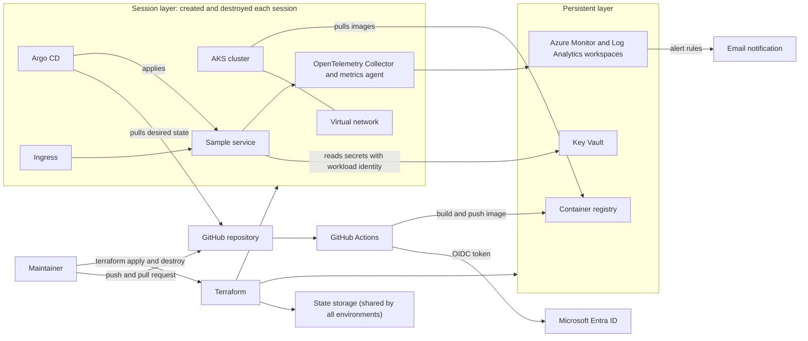
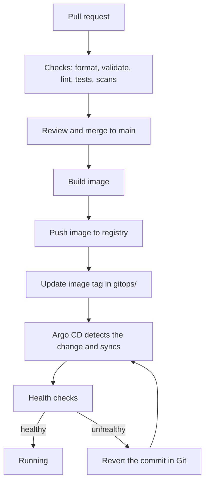

# Architecture

## 1. Status and purpose

This document describes the intended design of the platform. It is the first version.

**Built today:** the repository setup only (templates, contribution rules, license, security policy, decision records). **Everything else in this document is planned.** A free trial subscription exists. It holds no resources. No Terraform code exists.

Where a choice is not made, the text says so. Where a choice is made but not yet tested, it is marked as an assumption. Decisions are recorded as ADRs in [docs/adr/](adr/) and listed in section 14.

Tracking: this document is issue #15 under Epic 1 (#1).

## 2. Scope

The design covers:

- Azure infrastructure created with Terraform (Epic 2, #2).
- An AKS cluster and the services it needs (Epic 3, #3).
- Build, test and deploy pipelines, and GitOps delivery (Epic 4, #4).
- Metrics, logs, traces, SLOs and alerts (Epic 5, #5).
- Identity, secrets and policy checks (Epic 6, #6).
- Runbooks, incident handling and recovery (Epic 7, #7).
- Load tests, failure experiments and cost review (Epic 8, #8).

## 3. Goals

1. Build the whole platform from code. A new cluster can be created from the repository alone.
2. Deliver changes to the cluster only through Git.
3. Measure the reliability of one sample service against SLOs.
4. Practice incident response and recovery on a real system, and write down what happens.
5. Keep cost low and predictable by destroying the cluster after each work session.
6. Keep secrets out of the repository and avoid long-lived credentials.

## 4. Non-goals

- Multi-region or multi-cloud setups. One region is used.
- Compliance certification.
- Real user traffic or a real product. The workload is a small sample service.
- A service mesh. None is planned.
- An on-call rotation. There is one maintainer.
- High availability beyond what one small AKS cluster gives.

## 5. Facts, assumptions and unknowns

Facts, read by the maintainer on 2026-11-04:

- The Azure offer is a free trial. The spending limit is on.
- The region `northeurope` accepts resources.
- The total regional vCPU quota in `northeurope` is 4.
- The subscription holds no resources. The portal shows none. A test resource group was created and deleted.
- The Azure CLI is installed on the maintainer's machine.
- No Terraform code exists yet.

Assumptions:

1. One maintainer, working in sessions.
2. One Azure subscription, on a personal tenant. The tenant type has not been checked.
3. Region is `northeurope`. Resource prefix is `pp`. (ADR 0003)
4. Only one environment runs at a time. The 4 vCPU quota makes this a requirement.
5. The Kubernetes API server is public with an authorized IP range. (ADR 0005)
6. Infrastructure changes are applied from the maintainer's machine at first. Pipelines run checks and plans. (ADR 0007)
7. Alerts go to email. (ADR 0008)
8. Environments are separated by resource group inside the one subscription. The state storage account is shared. (ADR 0010)

Unknowns:

- Which VM sizes and families the trial allows in `northeurope`, and the vCPU quota per family. Only the total of 4 is known.
- Whether the quota can be raised on this offer.
- The credit amount and the trial end date. The portal does not show them yet.
- The monthly budget. This is an open item. It is not set.
- The language and shape of the sample service.
- The trace backend and the Grafana hosting choice. (ADR 0008)
- Whether the container registry stays between sessions or is rebuilt each time.
- The network policy engine and the policy tool for Epic 6.

## 6. System context

All components in this diagram are planned. Nothing is deployed.

The platform has two Terraform layers:

- **Persistent layer.** Small resources that must outlive a session: Key Vault, monitoring workspaces and (possibly) the container registry.
- **Session layer.** Resources created at the start of a session and destroyed at the end: virtual network, AKS cluster and everything inside it.

Both layers exist once per environment. The state storage is shared by all environments and sits outside both layers. The diagram shows one environment. See section 9 and ADR 0010.

## 7. Components

Every component below is planned. The status column is `planned` for all of them.

| Component | Role | Layer | Epic | Status |
|---|---|---|---|---|
| Terraform | Creates all Azure resources | n/a | 2 (#2) | planned |
| State storage | Holds Terraform state | shared | 2 (#2) | planned |
| Virtual network | Network for nodes | session | 2 (#2) | planned |
| Container registry | Stores images | persistent (assumption) | 2 (#2) | planned |
| Key Vault | Holds secrets | persistent | 6 (#6) | planned |
| AKS cluster | Runs workloads | session | 3 (#3) | planned |
| Ingress | Routes outside traffic to the service | session | 3 (#3) | planned |
| Namespaces, quotas, network policy | Cluster rules | session | 3 (#3) | planned |
| Sample service | The workload measured by SLOs | session | 3 (#3) | planned |
| GitHub Actions | Build, test, scan, publish | n/a | 4 (#4) | planned |
| Argo CD | Syncs cluster state from Git | session | 4 (#4) | planned |
| Azure Monitor and Log Analytics | Metric and log storage, alert rules | persistent | 5 (#5) | planned |
| OpenTelemetry Collector | Collects traces and metrics | session | 5 (#5) | planned |
| Grafana | Dashboards | undecided | 5 (#5) | planned |
| Policy checks | Block unsafe changes | n/a | 6 (#6) | planned |
| Runbooks and postmortems | Incident handling | n/a | 7 (#7) | planned |

### Capacity limit

The total regional vCPU quota in `northeurope` is 4. This is a fact. It limits the plan:

- One cluster at a time. A second cluster would use most or all of the quota.
- The node pools together stay within 4 vCPU, for example one node with 4 vCPU or two nodes with 2 vCPU. System pool nodes are expected to need at least 2 vCPU. This is checked at plan time.
- An upgrade or a node replacement creates an extra node first (surge). It needs free quota, and it cannot run when all 4 vCPU are in use. The plan is to pin versions, turn automatic upgrades off, and re-create the cluster instead of upgrading it. This is checked at plan time.
- The cluster autoscaler cannot add nodes beyond the quota.
- Argo CD, the metrics agent, the OpenTelemetry Collector and the sample service must fit in the capacity that is left. This is not measured.
- Nodes left behind by a failed destroy keep using quota and block the next create.

Node sizing is decided in the first AKS plan under Epic 2 (#2).

### Planned repository layout

Only `docs/` exists today. These are planned and may change. The rule for the three folders that overlap:

- `kubernetes/` holds plain manifests for cluster-level resources, such as namespaces and quotas.
- `helm/` holds charts written in this repository.
- `gitops/` holds Argo CD Application definitions and per-environment values. It points to the other two.

Other folders: `infrastructure/` for Terraform, `applications/` for the sample service, `monitoring/` for dashboards, alert rules and SLO definitions, `security/` for policies and scanning configuration.

## 8. Delivery flow

Planned flow from a code change to a running pod. Section 6 shows where each piece sits.

Notes:

- Rollback is a Git revert. Argo CD syncs the earlier state.
- Pull request runs have read-only access to Azure.
- How the image tag is updated (a commit by a pipeline or a manual commit) is not decided.
- Progressive delivery, such as canary releases, is not planned yet.

Infrastructure changes follow a separate path: pull request, plan, review, merge, then apply from the maintainer's machine (assumption, ADR 0007).

Promotion between environments is described in section 9.

## 9. Environments

The environments are `dev`, `staging` and `prod`. They are separated by resource group inside one subscription. The decision is ADR 0010, which is proposed. All of it is planned. Only `dev` is created first. `staging` and `prod` are defined here and are not created until they are needed.

### Resource groups

| Resource group | Holds | Created |
|---|---|---|
| `pp-shared-state-rg` | State storage account, by a manual bootstrap step | once |
| `pp-<env>-persistent-rg` | Key Vault, monitoring workspaces, possibly the container registry | per environment |
| `pp-<env>-session-rg` | Virtual network, AKS cluster | per environment, each session |
| `pp-<env>-aks-nodes-rg` | AKS node resources, named by Terraform | with the cluster |

Names follow ADR 0003. `shared` takes the place of `<env>` for the state storage only.

### State

- One blob container per environment in the shared storage account: `tfstate-<env>`.
- Two state files per environment, one per layer: `persistent.tfstate` and `session.tfstate`. (ADR 0004)
- Each environment is its own Terraform root. Terraform workspaces are not used. Environment inputs are written in `.tf` files, because `.gitignore` excludes `*.tfvars`.

### Access

- Role assignments for an environment are scoped to its resource groups, plus a data role on its state container.
- Each environment has its own pipeline identity, tied to the GitHub environment with the same name. Pull request runs use a read-only identity. (ADR 0007)
- The maintainer is Owner of the subscription. This is not a boundary between environments.

### Cost, quota and policy

- Resources carry the `env` tag, so cost can be filtered by environment. Per-environment budgets are planned once an amount is set. (ADR 0009)
- Quota and credit are shared by all environments. The regional vCPU quota is 4, so only one environment runs at a time. See the capacity limit in section 7.
- Policy is assigned per environment resource group where the policy tool allows it. A subscription-wide assignment is used only for a rule that applies to every environment.

### Promotion

- Infrastructure: pull request, plan, review, merge, apply to `dev`, then `staging`, then `prod`. Each step waits until the previous environment is checked.
- Workloads: a pull request changes the values under `gitops/<env>/`, in the same order. How the image tag is updated is an open question.
- Rollback is a Git revert in both paths.
- The check between environments is not defined. It is written when the sample service and its health checks exist.

### Teardown

The end-of-session teardown in ADR 0009 applies to every environment, including `prod`. Keeping `prod` running between sessions means revisiting ADR 0009.

### Limits

- Quota is shared by all environments in the subscription and region. The total regional vCPU quota is 4.
- The credit is one pool. Its amount is unknown.
- A subscription-level failure affects every environment. Examples are a disabled subscription, a deny policy at subscription scope and exhausted quota.
- The tenant is shared.
- The state storage account is shared. Losing it loses the state of every environment.
- `prod` is a name for the most protected environment. It is not a service with uptime.

## 10. Identity and secrets

All planned.

- **People.** The maintainer signs in with Microsoft Entra ID. Cluster access uses Entra ID and Azure RBAC.
- **Pipelines.** GitHub Actions logs in to Azure using OIDC federation. No client secret is stored in GitHub. (ADR 0007)
- **Workloads.** Pods use workload identity to read Key Vault. No Azure credentials are stored in the cluster.
- **Secrets.** Secrets live in Key Vault. They are not committed. `.gitignore` covers common secret files, and GitHub secret scanning and push protection are on for this repository.
- **Terraform state.** Access with Entra ID only. Shared key access is turned off. (ADR 0004)
- **Least privilege.** Each identity gets the lowest role that works, scoped as narrowly as possible. Roles for an environment are scoped to its resource groups. (ADR 0010)

Open: how Argo CD's own admin credential is created and stored.

## 11. Observability and SLOs

All planned. See ADR 0008.

- Metrics in Prometheus format go to an Azure Monitor workspace in the persistent layer. History survives cluster teardown.
- Logs go to a Log Analytics workspace.
- Traces come from OpenTelemetry in the sample service. The backend is not chosen.
- Dashboards in Grafana, stored as code in `monitoring/`.
- The sample service gets two SLIs to start: availability and latency. Targets are not set yet. Error budget alerts are planned.
- **SLO caveat.** The cluster is down between sessions. SLOs are measured over session time, with generated traffic. The window length is decided when the SLO is defined.
- Alerts notify an action group. Email is the first target (assumption). With one maintainer, there is no paging rotation.

## 12. Cost notes

All planned. No budget is set and no cost has been measured. See ADR 0009.

Plan:

- Create the session layer at the start of work and destroy it at the end.
- Keep the persistent layer small.
- Use small nodes and few of them.
- Tag all resources.
- Add an Azure budget with alerts once a monthly amount is set.
- Budgets and cost views per environment are planned. The credit is shared by all environments. (ADR 0010)

Main cost drivers to check in the Azure pricing calculator, at the time of use:

- Node virtual machines while they run.
- Disks and public IP addresses and load balancers attached to the cluster.
- Container registry tier.
- Log and metric ingestion and retention.
- Grafana, if the managed service is used.
- State storage, which is expected to be small.

The subscription is a free trial with the spending limit on. The credit amount and the trial end date are unknown, because the portal does not show them yet. When the portal shows them, record the credit amount, how long it lasts, which services it covers, and what happens to resources when it ends.

## 13. Risks

| Risk | Effect | Mitigation |
|---|---|---|
| Cluster left running after a session | Unplanned cost. Quota stays in use, so the next cluster cannot be created | End-of-session resource check. Budget alert once an amount is set. |
| Credit runs out or the trial ends | Work stops. With the spending limit on, resources are expected to be disabled (offer terms, not checked) | Record the credit amount and end date when the portal shows them. Track spend. |
| Regional vCPU quota is 4 | A cluster over 4 vCPU cannot be created. Upgrades and node replacement need spare quota | Size the cluster within 4 vCPU. Do not upgrade in place. Check VM sizes and per-family quota before the first AKS plan. |
| State lost or corrupted | Infrastructure cannot be managed from code | Versioning and soft delete on the state container. |
| Key Vault name held after deletion | Cannot re-create it | Keep Key Vault in the persistent layer. |
| Public API server | Larger attack surface | Authorized IP range, Entra ID authentication. |
| Shared subscription: quota, credit, subscription-level failure | All environments affected together | Run one environment at a time. Record the credit amount and end date when the portal shows them. Revisit separate subscriptions if the project outgrows this model. (ADR 0010) |
| Shared state storage account | State of every environment lost or exposed | Versioning and soft delete, a container per environment, Entra ID access only. (ADR 0004, ADR 0010) |
| One maintainer, and admin bypass on `main` | No second reviewer | Follow the pull request flow in CONTRIBUTING.md anyway. |
| Leaked credential in a public repository | Account access | Secret scanning, push protection, no stored secrets. Report as in SECURITY.md. |
| Tool versions drift | Builds break | Pin versions in Terraform and in pipelines when they exist. |

## 14. Decision records

| ADR | Title | Status |
|---|---|---|
| [0002](adr/0002-record-decisions-as-adrs.md) | Record decisions as ADRs | accepted |
| [0003](adr/0003-region-and-naming-convention.md) | Choose Azure region and resource naming convention | proposed |
| [0004](adr/0004-terraform-state-backend.md) | Use Azure Storage as the Terraform state backend | proposed |
| [0005](adr/0005-aks-networking-model.md) | Choose the AKS networking model | proposed |
| [0006](adr/0006-gitops-tool.md) | Choose the GitOps tool | proposed |
| [0007](adr/0007-github-actions-oidc-to-azure.md) | Authenticate GitHub Actions to Azure with OIDC | proposed |
| [0008](adr/0008-observability-stack.md) | Choose the metrics and dashboard stack | proposed |
| [0009](adr/0009-cost-guardrails.md) | Set cost guardrails and teardown policy | proposed |
| [0010](adr/0010-environment-separation.md) | Separate environments by resource group | proposed |

Other open decisions are listed in section 15.

## 15. Open questions

1. When is `staging` created, and what check must `dev` pass before a change moves on? (ADR 0010)
2. What monthly budget? It is an open item. It is not set, and the credit amount and trial end date are unknown. The first AKS plan under Epic 2 (#2) waits for them.
3. Does the container registry stay between sessions?
4. What is the sample service, and in which language?
5. Which trace backend, and which Grafana hosting?
6. Which network policy engine and which policy tool?
7. How is the Argo CD admin credential handled?
8. How is the image tag updated after a build?
9. What SLO targets and window fit a service that is only up during sessions?
10. How long does a full create take? This is measured once the code exists, and it sets the recovery time that Epic 7 (#7) can claim.
