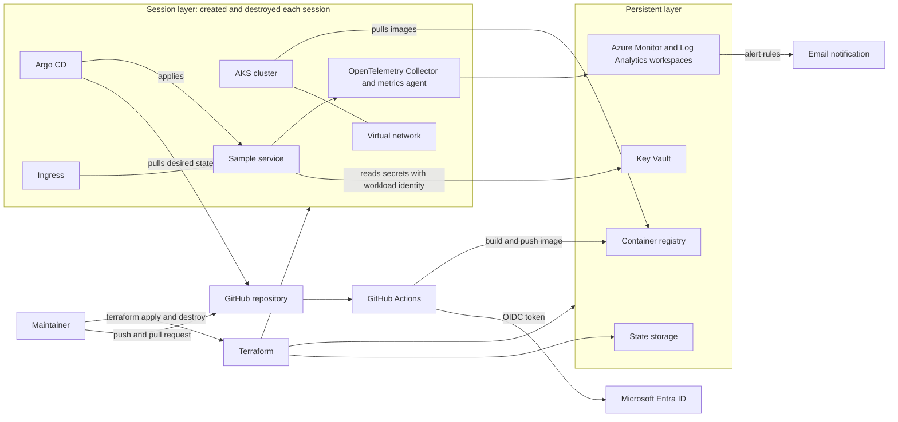
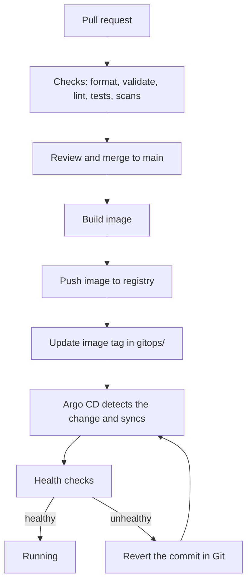

# Architecture

## 1. Status and purpose

This document describes the intended design of the platform. It is the first version.

**Built today:** the repository setup only (templates, contribution rules, license, security policy, decision records). **Everything else in this document is planned.** No Azure subscription exists yet, and no cloud resources have been created.

Where a choice is not made, the text says so. Where a choice is made but not yet tested, it is marked as an assumption. Decisions are recorded as ADRs in [docs/adr/](adr/) and listed in section 14.

Tracking: this document is issue #15 under Epic 1 (#1).

## 2. Scope

The design covers:

- Azure infrastructure created with Terraform (Epic 2, #2).
- An AKS cluster and the services it needs (Epic 3, #3).
- Build, test and deploy pipelines, and GitOps delivery (Epic 4, #4).
- Metrics, logs, traces, SLOs and alerts (Epic 5, #5).
- Identity, secrets and policy checks (Epic 6, #6).
- Runbooks, incident handling and recovery (Epic 7, #7).
- Load tests, failure experiments and cost review (Epic 8, #8).

## 3. Goals

1. Build the whole platform from code. A new cluster can be created from the repository alone.
2. Deliver changes to the cluster only through Git.
3. Measure the reliability of one sample service against SLOs.
4. Practice incident response and recovery on a real system, and write down what happens.
5. Keep cost low and predictable by destroying the cluster after each work session.
6. Keep secrets out of the repository and avoid long-lived credentials.

## 4. Non-goals

- Multi-region or multi-cloud setups. One region is used.
- Compliance certification.
- Real user traffic or a real product. The workload is a small sample service.
- A service mesh. None is planned.
- An on-call rotation. There is one maintainer.
- High availability beyond what one small AKS cluster gives.

## 5. Assumptions and unknowns

Assumptions:

1. One maintainer, working in sessions.
2. One Azure subscription on a personal tenant. It is not created yet. If it is created, it is expected to be a free credit account. The credit amount, its duration, and what happens when it ends must be checked at sign-up.
3. Region is `northeurope`. Resource prefix is `pp`. (ADR 0003)
4. Only one environment runs at a time.
5. The Kubernetes API server is public with an authorized IP range. (ADR 0005)
6. Infrastructure changes are applied from the maintainer's machine at first. Pipelines run checks and plans. (ADR 0007)
7. Alerts go to email. (ADR 0008)

Unknowns:

- Whether the chosen region has the VM sizes and quota the project needs. Check at sign-up.
- The monthly budget. It is not set.
- The language and shape of the sample service.
- The trace backend and the Grafana hosting choice. (ADR 0008)
- Whether the container registry stays between sessions or is rebuilt each time.
- The network policy engine and the policy tool for Epic 6.

## 6. System context

All components in this diagram are planned. Nothing is deployed.

The platform has two Terraform layers:

- **Persistent layer.** Small resources that must outlive a session: state storage, Key Vault, monitoring workspaces and (possibly) the container registry.
- **Session layer.** Resources created at the start of a session and destroyed at the end: virtual network, AKS cluster and everything inside it.

## 7. Components

Every component below is planned. The status column is `planned` for all of them.

| Component | Role | Layer | Epic | Status |
|---|---|---|---|---|
| Terraform | Creates all Azure resources | n/a | 2 (#2) | planned |
| State storage | Holds Terraform state | persistent | 2 (#2) | planned |
| Virtual network | Network for nodes | session | 2 (#2) | planned |
| Container registry | Stores images | persistent (assumption) | 2 (#2) | planned |
| Key Vault | Holds secrets | persistent | 6 (#6) | planned |
| AKS cluster | Runs workloads | session | 3 (#3) | planned |
| Ingress | Routes outside traffic to the service | session | 3 (#3) | planned |
| Namespaces, quotas, network policy | Cluster rules | session | 3 (#3) | planned |
| Sample service | The workload measured by SLOs | session | 3 (#3) | planned |
| GitHub Actions | Build, test, scan, publish | n/a | 4 (#4) | planned |
| Argo CD | Syncs cluster state from Git | session | 4 (#4) | planned |
| Azure Monitor and Log Analytics | Metric and log storage, alert rules | persistent | 5 (#5) | planned |
| OpenTelemetry Collector | Collects traces and metrics | session | 5 (#5) | planned |
| Grafana | Dashboards | undecided | 5 (#5) | planned |
| Policy checks | Block unsafe changes | n/a | 6 (#6) | planned |
| Runbooks and postmortems | Incident handling | n/a | 7 (#7) | planned |

### Planned repository layout

Only `docs/` exists today. These are planned and may change. The rule for the three folders that overlap:

- `kubernetes/` holds plain manifests for cluster-level resources, such as namespaces and quotas.
- `helm/` holds charts written in this repository.
- `gitops/` holds Argo CD Application definitions and per-environment values. It points to the other two.

Other folders: `infrastructure/` for Terraform, `applications/` for the sample service, `monitoring/` for dashboards, alert rules and SLO definitions, `security/` for policies and scanning configuration.

## 8. Delivery flow

Planned flow from a code change to a running pod. Section 6 shows where each piece sits.

Notes:

- Rollback is a Git revert. Argo CD syncs the earlier state.
- Pull request runs have read-only access to Azure.
- How the image tag is updated (a commit by a pipeline or a manual commit) is not decided.
- Progressive delivery, such as canary releases, is not planned yet.

Infrastructure changes follow a separate path: pull request, plan, review, merge, then apply from the maintainer's machine (assumption, ADR 0007).

## 9. Environments

The intended environments are `dev`, `staging` and `prod`. How they are separated (subscriptions or resource groups), how state is laid out per environment, who can access each one, and how a change moves between them is **pending in issue #16**. Nothing in this document decides it.

Until #16 is done:

- Names include `<env>` so a split is possible later. (ADR 0003)
- Only one environment is expected to exist at a time, starting with `dev`.

## 10. Identity and secrets

All planned.

- **People.** The maintainer signs in with Microsoft Entra ID. Cluster access uses Entra ID and Azure RBAC.
- **Pipelines.** GitHub Actions logs in to Azure using OIDC federation. No client secret is stored in GitHub. (ADR 0007)
- **Workloads.** Pods use workload identity to read Key Vault. No Azure credentials are stored in the cluster.
- **Secrets.** Secrets live in Key Vault. They are not committed. `.gitignore` covers common secret files, and GitHub secret scanning and push protection are on for this repository.
- **Terraform state.** Access with Entra ID only. Shared key access is turned off. (ADR 0004)
- **Least privilege.** Each identity gets the lowest role that works, scoped as narrowly as possible.

Open: how Argo CD's own admin credential is created and stored.

## 11. Observability and SLOs

All planned. See ADR 0008.

- Metrics in Prometheus format go to an Azure Monitor workspace in the persistent layer. History survives cluster teardown.
- Logs go to a Log Analytics workspace.
- Traces come from OpenTelemetry in the sample service. The backend is not chosen.
- Dashboards in Grafana, stored as code in `monitoring/`.
- The sample service gets two SLIs to start: availability and latency. Targets are not set yet. Error budget alerts are planned.
- **SLO caveat.** The cluster is down between sessions. SLOs are measured over session time, with generated traffic. The window length is decided when the SLO is defined.
- Alerts notify an action group. Email is the first target (assumption). With one maintainer, there is no paging rotation.

## 12. Cost notes

All planned. No budget is set and no cost has been measured. See ADR 0009.

Plan:

- Create the session layer at the start of work and destroy it at the end.
- Keep the persistent layer small.
- Use small nodes and few of them.
- Tag all resources.
- Add an Azure budget with alerts once a monthly amount is set.

Main cost drivers to check in the Azure pricing calculator, at the time of use:

- Node virtual machines while they run.
- Disks and public IP addresses and load balancers attached to the cluster.
- Container registry tier.
- Log and metric ingestion and retention.
- Grafana, if the managed service is used.
- State storage, which is expected to be small.

If a free credit account is used, check at sign-up: the credit amount, how long it lasts, which services it covers, and what happens to resources when it ends.

## 13. Risks

| Risk | Effect | Mitigation |
|---|---|---|
| Cluster left running after a session | Unplanned cost | End-of-session resource check. Budget alert once an amount is set. |
| Credit runs out or expires early | Work stops, resources may be disabled | Check terms at sign-up. Track spend. |
| Low VM quota on a new account | Cluster cannot be created | Check quota in `northeurope` before the first apply. |
| State lost or corrupted | Infrastructure cannot be managed from code | Versioning and soft delete on the state container. |
| Key Vault name held after deletion | Cannot re-create it | Keep Key Vault in the persistent layer. |
| Public API server | Larger attack surface | Authorized IP range, Entra ID authentication. |
| One maintainer, and admin bypass on `main` | No second reviewer | Follow the pull request flow in CONTRIBUTING.md anyway. |
| Leaked credential in a public repository | Account access | Secret scanning, push protection, no stored secrets. Report as in SECURITY.md. |
| Tool versions drift | Builds break | Pin versions in Terraform and in pipelines when they exist. |

## 14. Decision records

| ADR | Title | Status |
|---|---|---|
| [0002](adr/0002-record-decisions-as-adrs.md) | Record decisions as ADRs | accepted |
| [0003](adr/0003-region-and-naming-convention.md) | Choose Azure region and resource naming convention | proposed |
| [0004](adr/0004-terraform-state-backend.md) | Use Azure Storage as the Terraform state backend | proposed |
| [0005](adr/0005-aks-networking-model.md) | Choose the AKS networking model | proposed |
| [0006](adr/0006-gitops-tool.md) | Choose the GitOps tool | proposed |
| [0007](adr/0007-github-actions-oidc-to-azure.md) | Authenticate GitHub Actions to Azure with OIDC | proposed |
| [0008](adr/0008-observability-stack.md) | Choose the metrics and dashboard stack | proposed |
| [0009](adr/0009-cost-guardrails.md) | Set cost guardrails and teardown policy | proposed |

Still to be decided and recorded: environment separation (#16).

## 15. Open questions

1. Which separation model for dev, staging and prod? (#16)
2. What monthly budget? Is it set before the first apply?
3. Does the container registry stay between sessions?
4. What is the sample service, and in which language?
5. Which trace backend, and which Grafana hosting?
6. Which network policy engine and which policy tool?
7. How is the Argo CD admin credential handled?
8. How is the image tag updated after a build?
9. What SLO targets and window fit a service that is only up during sessions?
10. How long does a full create take? This is measured once the code exists, and it sets the recovery time that Epic 7 (#7) can claim.
