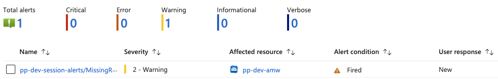
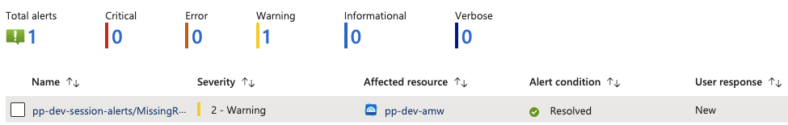
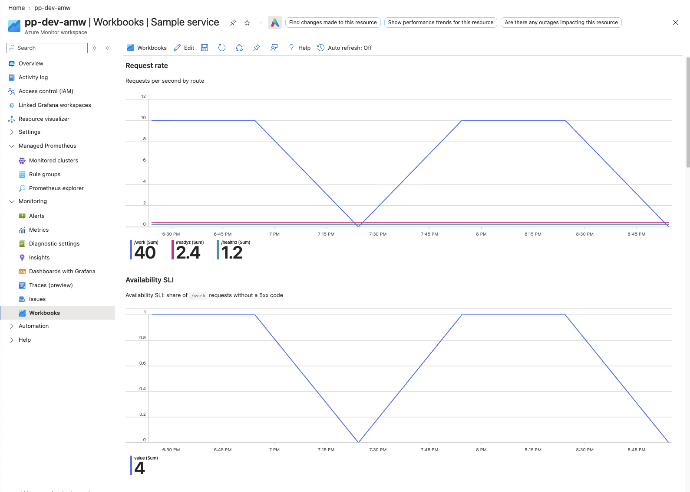
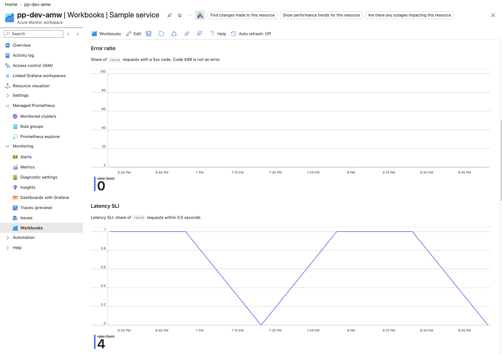
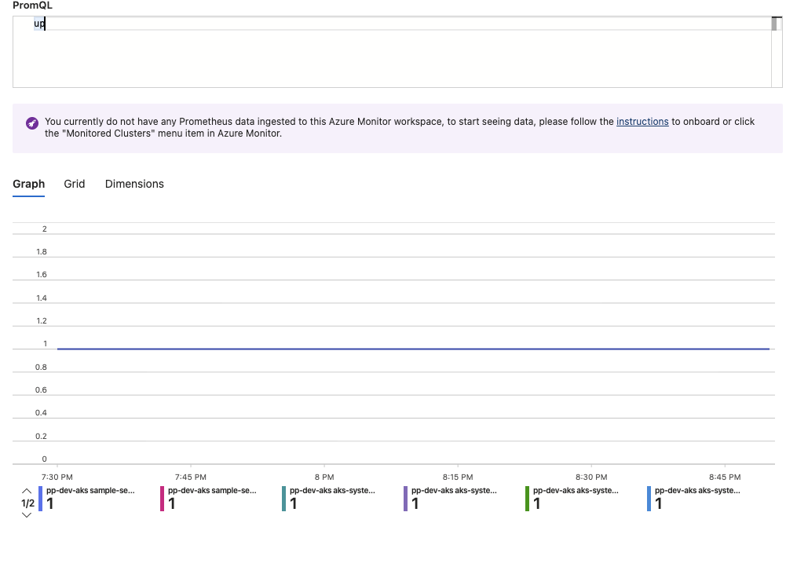
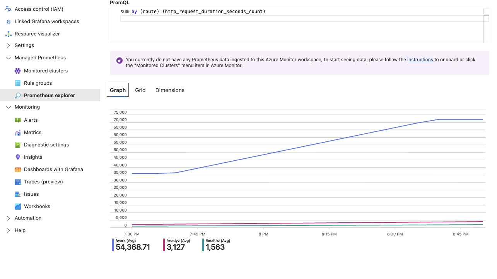
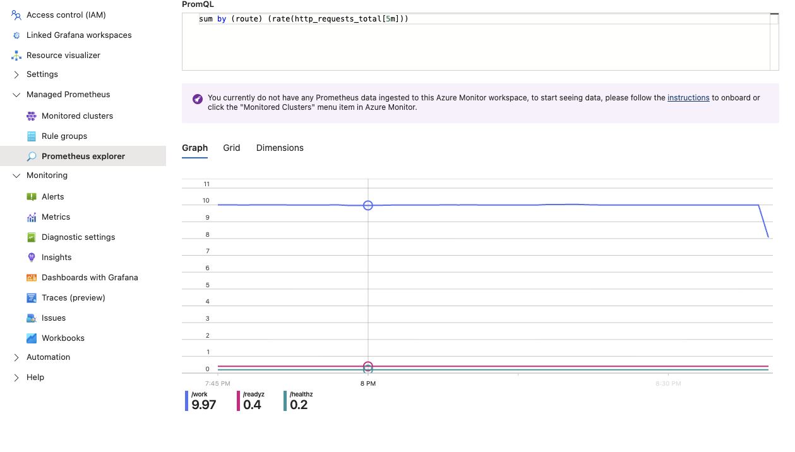
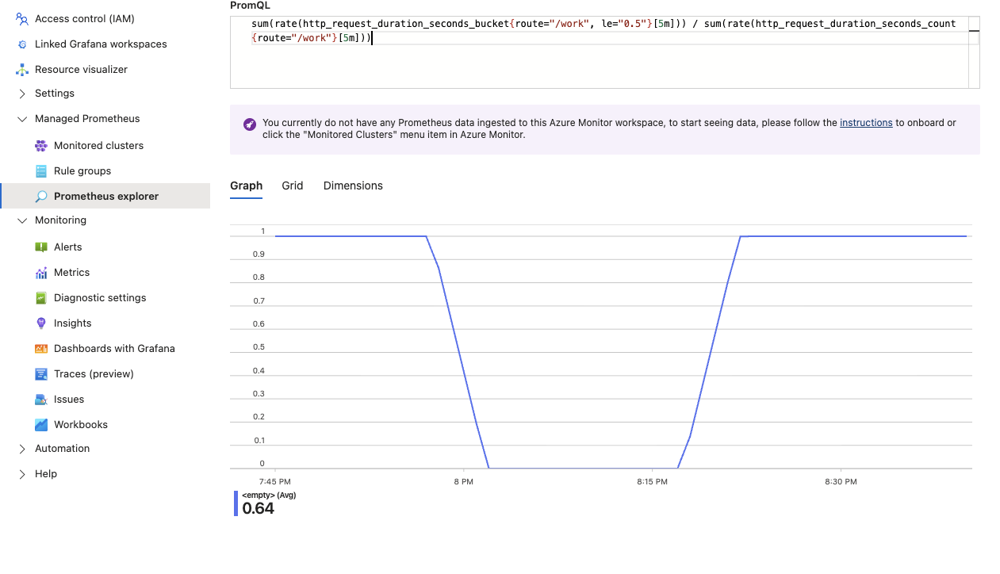
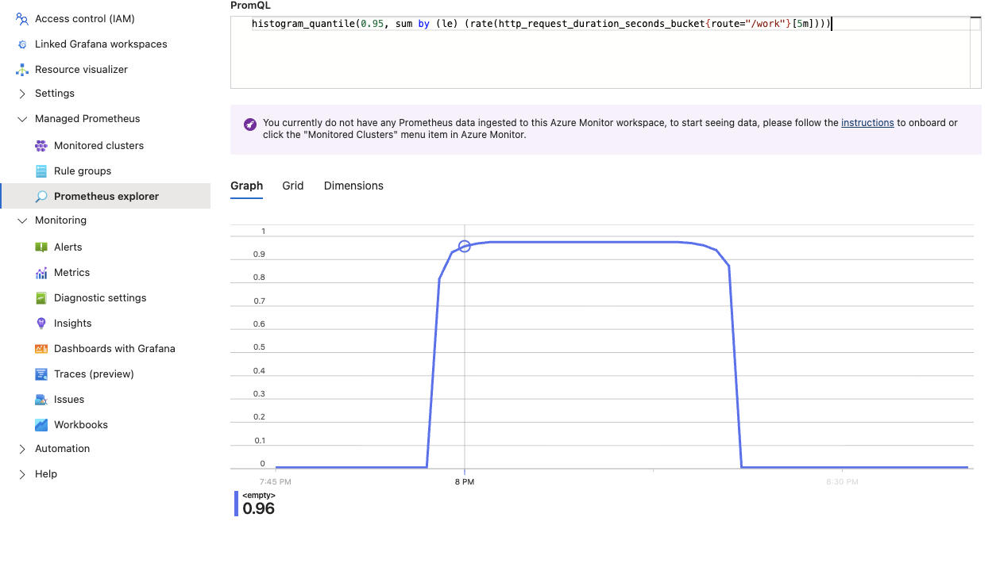

# Screenshots

These are portal screenshots of the Azure Monitor alert MissingRequestData and of the "Sample service" workbook in the Azure Monitor workspace `pp-dev-amw`. The images are in `assets/screenshots/`.

Click an image to enlarge it. Press Esc or click again to close it.

## Alert fired

The alerts list shows 1 total alert, counted under Warning. The alert is `pp-dev-session-alerts/MissingR…` (the name is cut off in the list), severity 2 - Warning, on `pp-dev-amw`, with the alert condition Fired and the user response New. See [experiment 5 of the Session 4 results](sessions/session-4-results.md) and the runbook [missing-request-data](runbooks/missing-request-data.md).

## Alert resolved

The same list shows the same alert with the alert condition Resolved and the user response New. See [experiment 5 of the Session 4 results](sessions/session-4-results.md) and the runbook [missing-request-data](runbooks/missing-request-data.md).

## Workbook: request rate and availability SLI

The Request rate chart shows requests per second by route, with a summary of 40 for `/work`, 2.4 for `/readyz` and 1.2 for `/healthz`. The `/work` line starts at 10, falls to 0 near 7:25 PM, returns to 10, and falls to 0 again at the right edge. The Availability SLI chart below it, the share of `/work` requests without a 5xx code, has the same shape between 1 and 0, with a summary value of 4. The SLIs are defined in [slos.md](slos.md).

## Workbook: error ratio and latency SLI

The Error ratio chart, the share of `/work` requests with a 5xx code, is flat at 0 over the range, with a summary value of 0. The Latency SLI chart, the share of `/work` requests within 0.5 seconds, starts at 1, falls to 0 near 7:25 PM, returns to 1, and falls to 0 again at the right edge, with a summary value of 4. The SLIs are defined in [slos.md](slos.md).

## Prometheus explorer

The five images show queries run in the Prometheus explorer of the Azure Monitor workspace `pp-dev-amw`. See the [Session 3 results](sessions/session-3-results.md).

### Targets up

The query is `up`. The graph is a flat line at 1, and the legend lists six series, two starting with `pp-dev-aks sample-se…` and four starting with `pp-dev-aks aks-syste…`, each with the value 1. The legend shows page 1 of 2.

### Request count by route

The query is `sum by (route) (http_request_duration_seconds_count)`. The `/work` line rises from near 35,000 to near 72,000 on the axis and then stays level. The legend shows 54,368.71 for `/work`, 3,127 for `/readyz` and 1,563 for `/healthz`, each marked Avg.

### Request rate by route

The query is `sum by (route) (rate(http_requests_total[5m]))`, the query in [request-rate.promql](https://github.com/Franklindot04/production-platform-Azure/blob/main/monitoring/prometheus/request-rate.promql). The `/work` line stays near 10 and drops to near 8 at the right edge. The legend shows 9.97 for `/work`, 0.4 for `/readyz` and 0.2 for `/healthz`.

### Latency SLI

The query is the ratio of `http_request_duration_seconds_bucket{route="/work", le="0.5"}` to `http_request_duration_seconds_count{route="/work"}`, both as `sum(rate(...[5m]))`, the query in [latency-sli.promql](https://github.com/Franklindot04/production-platform-Azure/blob/main/monitoring/prometheus/latency-sli.promql). The line is at 1, falls to 0, stays at 0 for a stretch and returns to 1. The legend shows 0.64 for the series `<empty>` (Avg). The SLI is defined in [slos.md](slos.md).

### Latency p95

The query is `histogram_quantile(0.95, sum by (le) (rate(http_request_duration_seconds_bucket{route="/work"}[5m])))`, the query in [latency-p95.promql](https://github.com/Franklindot04/production-platform-Azure/blob/main/monitoring/prometheus/latency-p95.promql). The line is at 0, rises to near 0.97, stays level and falls back to 0. The legend shows 0.96 for the series `<empty>`.

No Argo CD screenshot is included.
