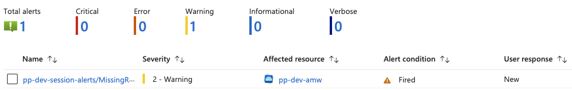
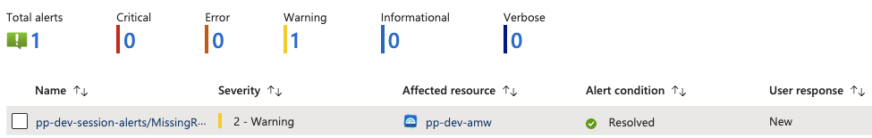

# Live session 4: runbooks, node drain and the missing data alert, results

Results of the run described in [session-4.md](session-4.md). Issue #149.

## Scope

The session created the `dev` session layer, ran the experiments of the plan, and destroyed the layer. A result is stated only where it was measured. Identifiers are masked.

## Cluster

| Step | Result |
|---|---|
| `session.sh up` | Planned 11 to add, 0 to change and 0 to destroy |
| `session.sh up --apply` | Added 11 resources. The cluster `pp-dev-aks` took 6 min 9 s to create. The rule group `pp-dev-session-alerts` was created in the same apply. The command took 7 min 34 s from start to exit 0. |
| `session.sh bootstrap` | Installed Argo CD and applied the `root` Application. It also set the ingress source range and created the secret `appinsights-connection` in the namespace `observability` |

The time taken by `session.sh bootstrap` and the state of the Applications after it were not recorded.

## Experiments

### 1. Delete a pod

Runbook: [pod-not-ready.md](../runbooks/pod-not-ready.md).

- The `kubectl get endpoints` command in the runbook prints a deprecation warning.
- First checks 1 to 4 and Verify 1 and 2 of the runbook were run and recorded. No other step of this runbook was recorded.
- One of the two sample service pods was deleted. Its replacement was created on the other node. It was listed as Running 3 s after the delete command, and both pods were ready 11 s after it.
- The events of the deleted pod show a readiness probe failure with HTTP status 503. The events of the replacement show Scheduled, Pulled, Created and Started.
- The Service endpoints listed two pod addresses at First check 4 and at Verify 2.

### 2. Change a resource with kubectl

Runbook: [argocd-drift.md](../runbooks/argocd-drift.md).

- Argo CD reverted the changed Deployment in 3 seconds.
- The change that was made and the steps run were not recorded.

### 3. Key Vault mount

Runbook: [key-vault-mount-fails.md](../runbooks/key-vault-mount-fails.md).

- Two corrections were found: one in check 7, and one in the cause of the failure of the `ls` command in Verify step 2.
- The wording of the corrections and the steps run were not recorded.

### 4. Image pull

Runbook: [image-pull-refused.md](../runbooks/image-pull-refused.md).

- A correction was found in check 5.
- The wording of the correction and the steps run were not recorded.

### 5. Missing data alert

Runbook: [missing-request-data.md](../runbooks/missing-request-data.md). Issue #136.

- The rule group is `pp-dev-session-alerts` and the rule is MissingRequestData, severity 2, with `for` of `PT15M` and the expression `absent_over_time(http_requests_total{route="/readyz"}[5m])`.
- The alert did not fire at the start of the session.
- Self-heal on the Applications `root` and `cluster-rules` was held back by setting the automated `syncPolicy` to null. It was restored afterwards.
- Deleting the policy `allow-metrics-scrape` alone did not stop an existing scrape: the series kept arriving after the delete.
- The data stopped when the sample service pods were deleted.
- The mail "Fired" carried the time 10:18:05 UTC. The mail "Resolved" carried the time 10:34:04 UTC.
- The time of the data stop was not recorded.
- The steps of the runbook that were run were not recorded.
- No decision on the `for` value of 15 minutes was made.

The alert in the Fired condition.

The same alert in the Resolved condition.

### 6. Network policy block

Runbook: [network-policy-blocks-service.md](../runbooks/network-policy-blocks-service.md).

- The deletion of `allow-metrics-scrape` and its result are under experiment 5.
- First checks 1 to 6 and Verify 1 to 3 of the runbook were run and recorded. The policy `allow-ingress-controller` was deleted for the experiment.
- After the delete, `default-deny` was still present. `kubectl describe networkpolicy default-deny` shows that it selects all pods and isolates them for ingress and egress.
- Both sample service pods stayed `1/1` Running, and the Service endpoints still listed two pod addresses.
- The k6 smoke test through the ingress passed 0 of 50 checks, and the average request duration was 15.08 s.
- The policy was restored with `kubectl apply -f kubernetes/network-policies/apps.yaml`, 29 s after the delete. The same smoke test then passed all 51 checks, with an average request duration of 83.15 ms and a p95 of 85.97 ms.
- Automated sync on `root` was switched on again with a patch of the `syncPolicy`. After 40 s the Applications `cluster-rules`, `opentelemetry-collector`, `root` and `sample-service` were Synced and Healthy.

### 7. Node drain

Runbook: [node-drain.md](../runbooks/node-drain.md). Issue #98.

- The drain completed with exit 0.
- Four pods stayed Pending until the node was uncordoned.
- The cause shown by the cluster was not enough CPU on the remaining node. The nodes are two Standard_D2s_v5 with 1900m CPU allocatable on each, and the DaemonSets request 604m on each.
- Two drain runs were logged. Both end with the node drained. The first shows evictions held back by the disruption budgets of metrics-server and konnectivity-agent.
- The four Pending pods were `nginx-668c89f4c-txp9z` in `app-routing-system`, and `argocd-application-controller-0`, `argocd-repo-server-75c6987d7d-rw5dr` and `argocd-server-6b5fc579f-m594b` in `argocd`.
- After the drain, `kubectl describe nodes` showed CPU requests of 604m (31%) on the drained node and 1877m (98%) on the other node. The requests per node before the drain were not recorded.
- The drain took 1 min 17 s and exited 0. Both sample service pods ran on the other node after it.
- The first check that found no Pending pod ran 17 s after the uncordon. The check runs every 5 seconds.

### 8. Remove a node instance

No runbook.

- `az aks nodepool delete-machines` takes the node name as the value of `--machine-names`, and that removed the node.
- AKS did not recreate the node within 3 minutes.
- Scaling the pool back with `az aks nodepool scale` restored it.
- Not measured: the pod state during the single node phase.
- The time until the restored node was `Ready` was not recorded.

## Teardown

The destroy repeat test (#89) was run with a lock. Every run below is `session.sh down --yes`.

| Step | Result |
|---|---|
| Lock | A `CanNotDelete` lock named `session-test-lock` was created on `pp-dev-session-rg` |
| First `down --yes` | Exit 1 after 2 min 43 s. The errors were `ScopeLocked` on the Prometheus rule group `pp-dev-session-alerts` and on the scoped data collection rule association. The script printed that it would try once more after 120 seconds, tried, and stopped again with the message to run `down --yes` again and then `check` |
| Lock removal | The lock was deleted |
| Second `down --yes` | Exit 1 after 17 min 57 s. The cluster delete failed with `ResourceGroupDeletionBlocked` on the node resource group `pp-dev-aks-nodes-rg`. The message names a public IP address of the load balancer. The retry failed the same way. The cluster state was Failed with power state Running |
| `check` after the second run | Exit 1. Remaining: the cluster, the virtual network, the node resource group, 2 public IP addresses, 1 load balancer and 1 scale set |
| Third `down --yes` | The cluster delete failed once and the retry succeeded. `Destroy complete! Resources: 4 destroyed`. Exit 0 |
| `check` after the third run | Exit 0. Session layer groups none, compute none, public IP addresses none, load balancers none, managed disks none, unexpected resource groups none |

- `session.sh down` planned 0 to add, 0 to change and 11 to destroy.
- The retry inside `down --yes` ran in all three runs. It failed in the first two and succeeded in the third.
- The cause of the block on the node resource group was not found.
- The account that ran the session created and deleted the lock without an error.

## Reading notes

- A destroy can need more than one run. A cluster in the state Failed with `ResourceGroupDeletionBlocked` was cleared by running `down --yes` again.
- `check` decides when the session is done.

## Not measured

- The pod state during the single node phase of the node removal.
